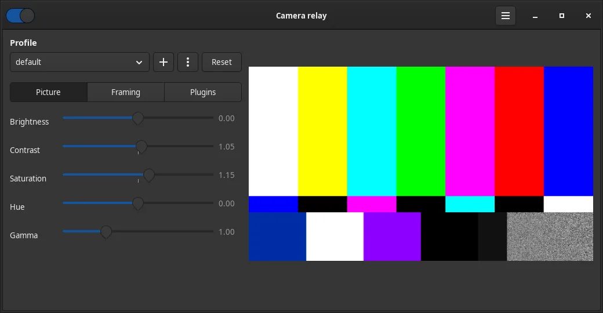
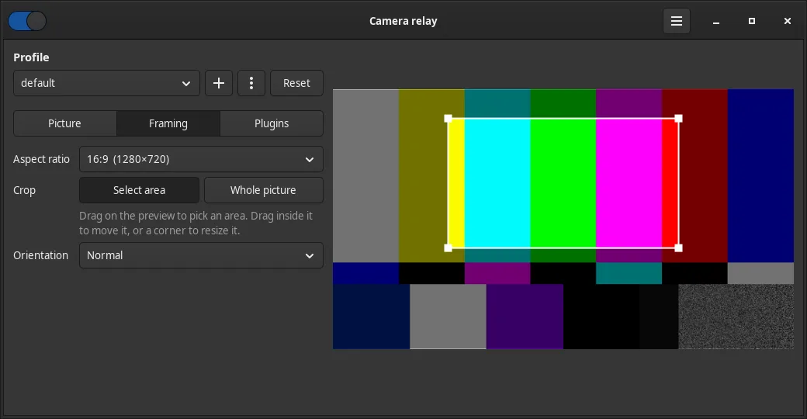
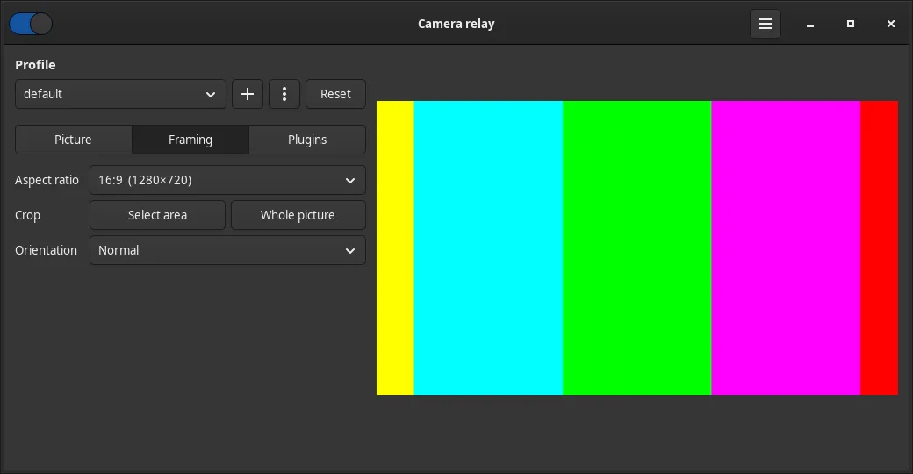

# camera-relay

A virtual webcam for Linux. It reads your real camera, lets you fix the picture live (colour, crop, clean-up), and offers the result to browsers and call apps as **Built-in Camera**.



## What it does

- 🎚️ **Live picture adjustments**: brightness, contrast, saturation, hue, gamma, flip and rotate. Changes show at once, even mid-call.
- ✂️ **Crop like a photo**: drag a box on the preview. Pick the shape: 16:9, 4:3 or 1:1.
- 🧩 **Plugins**: **Clean up** takes the grain out of a dark picture, **Soften** smooths skin. Add your own: [docs/plugins.md](docs/plugins.md).
- 🗂️ **Profiles**: one per app or room (Zoom, Teams, the dim office), each with its own picture, crop and plugins.
- 🔴 **Tray icon**: a webcam with a red eye while the camera is on. Click to turn it on or off; right click for profiles and settings.
- 🚀 **Start on login**, with or without the camera on.
- ⌨️ **Command line** for shortcuts and scripts.

| Select an area | The result |
| --- | --- |
|  |  |

## Install

```bash
curl -fsSL https://github.com/rj-xy/camera-relay/releases/latest/download/install.sh | bash
```

The installer puts `camera-relay` in `~/.local/bin` and adds **Camera Relay** to your app menu. It checks for the system packages below and offers to install the missing ones with `sudo`. Nothing else needs root.

Then start it from the app menu, or run `camera-relay`. Open a call or <https://webcamtests.com> and pick **Built-in Camera**.

## Requirements

| | |
| --- | --- |
| 🐧 Linux, x86_64 | Ubuntu 24.04+ and its flavours (Kubuntu, Pop!_OS, Mint 22+), Debian 13+, Fedora 41+, Arch, Manjaro, EndeavourOS, openSUSE Tumbleweed |
| 🔊 PipeWire | The default audio and video server on all of the above |
| 📷 A camera | libcamera or V4L2 |
| 🔘 Tray (optional) | KDE Plasma: built in. GNOME: the AppIndicator extension (on by default in Ubuntu). Without a tray, use the settings window and the command line |

🔴 Not supported: Debian 12, Ubuntu 22.04 and older (GTK and glibc too old), ARM.

### System packages

The installer handles these. To install them yourself:

| Distribution | Command |
| --- | --- |
| Debian, Ubuntu, Mint, Pop!_OS | `sudo apt install libgtk-4-1 gstreamer1.0-plugins-base gstreamer1.0-plugins-good gstreamer1.0-pipewire gstreamer1.0-libcamera` |
| Fedora | `sudo dnf install gtk4 gstreamer1-plugins-base gstreamer1-plugins-good pipewire-gstreamer libcamera-gstreamer` |
| Arch, Manjaro, EndeavourOS | `sudo pacman -S --needed gtk4 gst-plugins-base gst-plugins-good gst-plugin-pipewire gst-plugin-libcamera` |
| openSUSE Tumbleweed | `sudo zypper install libgtk-4-1 gstreamer-plugins-base gstreamer-plugins-good gstreamer-plugin-pipewire gstreamer-plugins-libcamera` |

### Your camera

The defaults suit the laptop it was built on, a Dell XPS 14 with an OmniVision OV08X40 sensor (it must capture at 2560×1440, with its own colour tuning). For any other camera, edit `~/.config/camera-relay/config.toml`, then quit and start the app again:

```toml
[camera]
source = "libcamera"     # or "v4l2" for a plain USB webcam
device = ""              # empty: the first camera; or a libcamera name, or /dev/video0 for v4l2
capture_width = 0        # 0: the camera picks its size
capture_height = 0
tuning_file = ""         # the default file is for the OV08X40 only

[camera.properties]      # leave empty
```

No camera, or just trying it out? `source = "test"` shows a test pattern.

On the XPS 14 (or another Intel IPU7 laptop with this sensor), fetch the colour tuning file, and hide the camera devices that never give a picture (and PipeWire's own libcamera camera, which crashes):

```bash
raw=https://raw.githubusercontent.com/rj-xy/camera-relay/main/legacy-relay
curl -fsSL --create-dirs -o ~/.config/camera-relay/ov08x40.yaml $raw/ov08x40.yaml
curl -fsSL --create-dirs -o ~/.config/wireplumber/wireplumber.conf.d/51-camera-relay.conf \
  $raw/51-camera-relay.conf
systemctl --user restart wireplumber
```

If `cam -l` lists no camera at all, the kernel is missing the `intel_cvs` driver: see the bring-up notes in [legacy-relay/README.md](legacy-relay/README.md).

## Use it

- **Tray icon**: left click turns the camera on or off. Right click: **Camera on**, **Profile ▸**, **Settings…**, **Quit**.
- **Settings window** (`camera-relay settings`, or **Camera Relay** in the app menu):
  - the switch top left turns the camera on or off;
  - **Profile**: pick one, **+** for a new one, **⋮** to rename or delete, **Reset** for a neutral picture;
  - tabs: **Picture** (colour), **Framing** (shape, crop, rotation), **Plugins**;
  - **☰** top right: start on login.

Every change applies live and is saved at once.

### Command line

| Command | What it does |
| --- | --- |
| `camera-relay` | Start the app and its tray icon |
| `camera-relay toggle`, `start`, `stop` | Camera on or off |
| `camera-relay status` | On or off, the profile and its settings |
| `camera-relay settings` | Open the settings window |
| `camera-relay profile [<name>]` | List profiles, or switch to one (a new name copies the current profile) |
| `camera-relay rename-profile <from> <to>`, `delete-profile <name>` | Tidy up profiles |
| `camera-relay set <key> <value>` | Change one setting, live: `set brightness 0.1`, `set aspect 4:3`, `set plugins cleanup,soften`, `set cleanup.strength 0.7` |
| `camera-relay autostart [off\|app\|camera]` | Start on login: nothing, the app, or the app with the camera on |
| `camera-relay update` | Install the latest release |

`toggle`, `start` and `settings` start the app if it isn't running, so they work as keyboard shortcuts. `camera-relay set --help` lists every key.

Settings live in `~/.config/camera-relay/`: `config.toml` (camera and output) and `profiles/<name>.toml`. Logs: `journalctl -t camera-relay -f`.

## Update and uninstall

```bash
camera-relay update     # latest release, in place; restart the app after
```

To remove it:

```bash
camera-relay autostart off
rm ~/.local/bin/camera-relay ~/.local/share/applications/camera-relay.desktop
rm -r ~/.config/camera-relay    # your settings and profiles, if you want them gone too
```

## Build from source

See [docs/contributing.md](docs/contributing.md) for the build packages per distribution, tests and the release process. In short: `cargo build --release`.

## More

- [docs/plugins.md](docs/plugins.md): use, add and write plugins.
- [docs/contributing.md](docs/contributing.md): build, test, release.
- [docs/architecture.md](docs/architecture.md): the pipeline, threads, config and milestones.
- [docs/language-choice.md](docs/language-choice.md): why Rust.
- [legacy-relay/](legacy-relay/): the shell-script relay this app replaces, with hardware notes for the OV08X40. If it's installed, remove it first; the installer tells you how.

## Licence

MIT, see [LICENSE](LICENSE).
