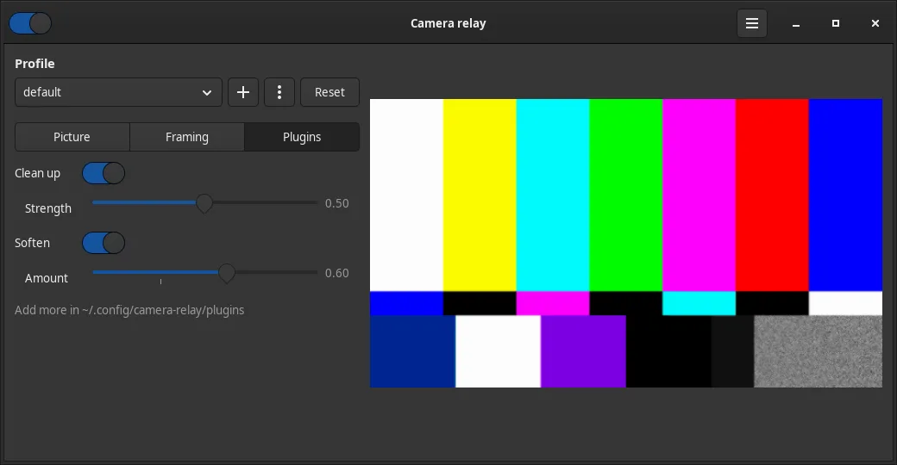

# Plugins

Plugins are effects that run on the picture, one after another, before it goes out to your call. Two come built in:

| Plugin | What it does | Setting |
| --- | --- | --- |
| **Clean up** (`cleanup`) | Takes the grain out of a dark picture. Still areas are averaged over frames; movement shows at once | Strength |
| **Soften** (`soften`) | A gentle blur of the brightness, for smoother skin. Colour stays sharp | Amount |

## Use them

In the settings window, open the **Plugins** tab. Turn a plugin on with its switch, then drag its sliders: they act live.



Or from the command line:

```bash
camera-relay set plugins cleanup,soften   # these, in this order
camera-relay set cleanup.strength 0.7     # one setting, live
camera-relay set plugins ""               # all off
camera-relay status                       # what's on
```

- Each profile has its own plugins and settings.
- Turning a plugin on or off restarts the camera for about a second. Sliders don't.
- Plugins run in the order of the list. The window adds a plugin to the end when you turn it on.

## Add a plugin

A plugin is a folder in `~/.config/camera-relay/plugins/`, named after the plugin's id (letters, digits, `-` and `_`), with a `plugin.toml` inside. Quit and start the app again to load new or changed plugins.

This one makes the picture look like an old film, using GStreamer's `agingtv` element:

```
~/.config/camera-relay/plugins/
└── old-film/
    └── plugin.toml
```

```toml
name = "Old film"
description = "Scratches, dust and a sepia tint."
pipeline = "agingtv name=aging"

[[settings]]
key = "scratches"
label = "Scratches"
element = "aging"
property = "scratch-lines"
min = 0
max = 20
default = 7
```

It shows up on the **Plugins** tab as **Old film**, and on the command line as `old-film` (`set old-film.scratches 12`).

A folder with the same id as a built-in plugin replaces it.

### plugin.toml

| Key | |
| --- | --- |
| `name` | Shown in the window |
| `description` | Optional. The tooltip |
| `pipeline` | One or more GStreamer elements, as `gst-launch-1.0` takes them: `agingtv name=aging ! videobalance saturation=0`. Give `name=` to any element a slider controls |
| `[[settings]]` | Optional, one per slider |

Each setting:

| Key | |
| --- | --- |
| `key` | The id on the command line (`<plugin>.<key>`) and in profile files |
| `label` | Shown next to the slider |
| `element` | The `name=` of the element in `pipeline` |
| `property` | The element's property. A number: floats as they are, integers rounded. Not enums or text |
| `min`, `max`, `default` | The slider's range and starting value |

Look up elements and their properties with `gst-inspect-1.0`, and list what's installed with `gst-inspect-1.0 | grep -i video`. Many effects come with `gstreamer1.0-plugins-good` (`agingtv`, `edgetv`, `warptv`, `videobalance`) or `-bad` (`gaussianblur`).

The app wraps the chain in `videoconvert` on both sides, so any element that takes raw video works. It runs at the output size (1280×720 by default), after the crop and before the **Picture** tab's colour.

Try a chain before writing the file:

```bash
gst-launch-1.0 videotestsrc ! videoconvert ! agingtv scratch-lines=12 ! videoconvert ! autovideosink
```

## Write your own element

When no GStreamer element does what you want, write one: a GStreamer plugin library (`.so`) in C, Rust ([gst-plugins-rs](https://gitlab.freedesktop.org/gstreamer/gst-plugins-rs) has templates) or any language with GStreamer bindings. Put the `.so` in the plugin's folder, next to `plugin.toml`; the app loads it before building the pipeline.

```
~/.config/camera-relay/plugins/
└── my-effect/
    ├── plugin.toml          # pipeline = "myeffect name=fx"
    └── libgstmyeffect.so
```

Check that GStreamer finds it:

```bash
GST_PLUGIN_PATH=~/.config/camera-relay/plugins/my-effect gst-inspect-1.0 myeffect
```

For live sliders, mark the properties `GST_PARAM_MUTABLE_PLAYING` and read them per frame. The built-in Clean up and Soften elements are examples in Rust: [src/plugins/denoise.rs](../src/plugins/denoise.rs) and [src/plugins/soften.rs](../src/plugins/soften.rs).

## When a plugin can't run

The **Plugins** tab shows the plugin greyed out with **🟠 Can't run** and the reason; `camera-relay set plugins <id>` refuses it with the same reason. The camera keeps running without it.

| Reason | Fix |
| --- | --- |
| the pipeline doesn't build (a missing GStreamer element?) | Install the package with that element (`gst-inspect-1.0 <element>` says if it's there), or check the `.so` is in the folder |
| setting …: no element named "…" | Add `name=…` to that element in `pipeline` |
| setting …: … has no property "…" | Check the spelling with `gst-inspect-1.0 <element>` |
| setting …: needs min < max and the default between them | Fix the numbers |

A `plugin.toml` that doesn't parse isn't listed at all. The log says why: `journalctl -t camera-relay | grep -i plugin`.
